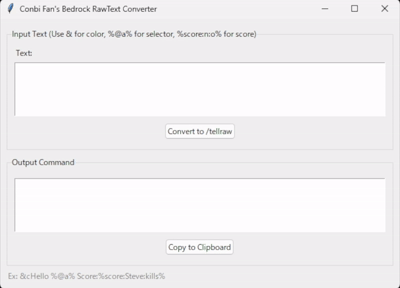

# Conbi Fan's Bedrock RawText Converter

A lightweight, privacy-focused GUI tool to convert plain text into Minecraft Bedrock Edition `/tellraw` commands.



## 🚀 Features

- **Instant Conversion**: Type text and get a valid `/tellraw` command instantly.
- **Special Syntax Support**:
  - `&` → `§` (Color codes)
  - `%@selector%` → Selector support (e.g., `%@a%`)
  - `%score:name:objective%` → Scoreboard support
- **Privacy First**: No internet connection required. All processing is done locally on your PC.
- **Open Source**: Written in Python. Verify the code yourself for safety.
- **No KYC/Account**: Purchase the standalone executable without providing personal information.

## 🛒 Download

| Version | Description | Link |
| :--- | :--- | :--- |
| **Standalone (exe)** | No Python installation required. Ready to use. | [Buy on Sell.app](https://conbifan.sell.app/product/bedrockrawtext-converter]) |
| **Source Code** | For developers who want to inspect or modify the code. | Free (This Repository) |

> 💰 **Accepted Payments**: Cryptocurrency only (USDT, XMR, BTC, etc.) via [NowPayments](https://nowpayments.io/donation/conbifan).

## 💻 How to Run from Source

If you have Python installed, you can run this tool for free.

### Requirements
- Python 3.10+
- `tkinter` (Usually included with Python)
- `pyperclip`

### Installation
1. Clone this repository:
   ```bash
   git clone https://github.com/ConbiFan/bedrock-rawtext-converter.git
   cd bedrock-rawtext-converter
